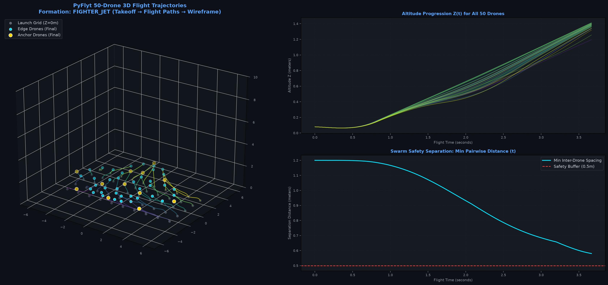

# Text2Swarm 🛸

> Convert natural language prompts into recognizable 3D drone swarm wireframe formations ($N = 15$ to $200+$ drones) with realistic multi-UAV physics simulation.

Text2Swarm combines a dataset of **7,450+ clean 3D wireframe models** (derived from KeypointNet) with a **Semantic RAG system**, a **Human Perception Subdivision algorithm**, and a **PyFlyt multi-UAV aerodynamics & physics simulator** to plan and fly drone light show formations.

---

## ⚡ Quick Start

### 1. Requirements

The core pipeline runs **100% on CPU** with fast inference (~24ms RAG retrieval):

```bash
conda activate s2f
pip install sentence-transformers torch pyflyt numpy scipy matplotlib plotly
```

---

## 🔍 Semantic RAG Swarm Generator (CLI)

Test the RAG swarm generator directly from your terminal using `test_rag.py`:

```bash
# 1. Automated Benchmark: Tests 16 queries (in-domain + out-of-domain) with a full scorecard
python test_rag.py --benchmark

# 2. Interactive REPL Mode: Keeps model in memory for instant (~20ms) testing
python test_rag.py --interactive

# 3. Single Query Test:
python test_rag.py "a supersonic combat fighter jet" --drones 45

# 4. Out-of-domain rejection (returns: 'this formation is not valid')
python test_rag.py "a slice of hot pepperoni pizza"
```

The generated 3D swarm plot is saved automatically to [`assets/test_rag_output.png`](assets/test_rag_output.png).

---

## 🚁 Swarm Movement & Physics Simulation (PyFlyt)

Simulate **50 quadcopter drones** taking off from a ground launch grid and flying into a 3D wireframe formation with full 6-DOF aerodynamics and collision avoidance:

```bash
# 1. Live 3D OpenGL Window (Watch the drones fly on screen in real time):
python simulate_swarm_pyflyt.py --gui

# 2. Fast Headless Physics Engine:
python simulate_swarm_pyflyt.py
```

### 🎮 Free 6-DOF Camera Controls (`--gui` mode)
> [!TIP]
> Click inside the PyBullet window to give it keyboard focus before moving:

| Action | Controls |
| :--- | :--- |
| **Fly Forward / Backward** | `W` / `S` (or `Up` / `Down` Arrow keys) |
| **Strafe Left / Right** | `A` / `D` (or `Left` / `Right` Arrow keys) |
| **Ascend (Fly Up)** | `Space` or `E` |
| **Descend (Fly Down)** | `C` or `Q` |
| **Zoom In / Out** | `+` / `-` (or mouse scroll wheel) |
| **Rotate / Orbit View** | Hold `Ctrl` + **Left-Click Drag** |

---

## 📁 Clean Repository Structure

```text
Text2Swarm/
├── test_rag.py                       # CLI test tool (query -> RAG -> subdivision -> 3D render)
├── simulate_swarm_pyflyt.py          # 50-drone multi-UAV physics, Hungarian assignment & PyFlyt GUI
├── 01_dataset_generation.ipynb       # KeypointNet extraction & 3D wireframe topology synthesis
├── 02_wireframe_subdivision.ipynb    # Bottom-up anchor + proportional edge subdivision & N_min demo
├── 03_rag_swarm_generator.ipynb      # Semantic RAG prompt matching & interactive 3D visualizations
├── sample_wireframes.json            # 4 reference CAD models (fighter jet, star, chair, house)
├── README.md                         # Project documentation and architecture guide
├── data/
│   ├── keypointnet_wireframes.json   # 7,454 verified 3D wireframe models (≤ 20 keypoints, 16 classes)
│   ├── sample_wireframes.json        # Reference CAD models copy
│   ├── wireframes_embeddings.npy     # Precomputed 384-d normalized vector embeddings (11 MB)
│   └── wireframes_keys.json          # Index list mapping row indices to model IDs
└── assets/
    ├── pyflyt_50_drones_movement.png     # 50-drone flight trajectories & telemetry in PyFlyt
    ├── test_rag_output.png               # Output generated by test_rag.py
    ├── rag_retrieved_swarms_gallery.png  # RAG prompt-to-swarm visual matches
    ├── samples_20_min_drones_gallery.png # 20 shapes at perceptual minimum drone count (N_min)
    └── samples_20_wireframes_gallery.png # 20 sample 3D wireframe skeletons
```

---

## 🧠 Project Architecture & Logic: How It Works

Text2Swarm solves three fundamental challenges in drone light shows:
1. **Semantic Understanding:** Interpreting arbitrary user prompts into structured 3D geometry without unconstrained, disconnected point clouds.
2. **Human Perceptual Recognition:** Ensuring a sparse constellation of lights in the night sky looks like an actual object to a human spectator on the ground.
3. **Physical Feasibility & Collision-Free Flight:** Planning trajectories from ground takeoff to target formation while obeying aerodynamics and avoiding mid-air collisions.

```
                    ┌───────────────────────────────┐
                    │  User Prompt: "fighter jet"   │
                    └───────────────┬───────────────┘
                                    │
                                    ▼
       ┌─────────────────────────────────────────────────────────┐
       │ 1. Semantic RAG Retrieval (all-MiniLM-L6-v2)            │
       │    • Precomputed 384-d normalized embeddings            │
       │    • Exact Cosine Similarity vs 7,450+ 3D models        │
       │    • Threshold Check: Similarity ≥ 0.30                 │
       │      (Rejection: "this formation is not valid")         │
       └────────────────────────────┬────────────────────────────┘
                                    │ Single Closest Wireframe Model
                                    ▼
       ┌─────────────────────────────────────────────────────────┐
       │ 2. Human Perception Subdivision ($N_{\min}$)            │
       │    • Mandate K corner anchors (gold)                    │
       │    • Calculate N_min based on edge lengths & d_gap      │
       │    • Proportional edge interpolation (cyan)             │
       │    • Scale & translate to sky altitude (e.g. Z = 7m)    │
       └────────────────────────────┬────────────────────────────┘
                                    │ 3D Formation Waypoints
                                    ▼
       ┌─────────────────────────────────────────────────────────┐
       │ 3. Hungarian Optimal Assignment                         │
       │    • Cost matrix: Euclidean distance (ground -> target) │
       │    • Solves min-cost matching: O(N³)                    │
       │    • Prevents path intersections & minimizes flight time │
       └────────────────────────────┬────────────────────────────┘
                                    │ Matched Waypoint Pairs
                                    ▼
       ┌─────────────────────────────────────────────────────────┐
       │ 4. Quintic S-Curve Minimum-Jerk Trajectory Planning     │
       │    • s(t) = 10τ³ - 15τ⁴ + 6τ⁵                          │
       │    • Zero initial & final velocity/acceleration         │
       └────────────────────────────┬────────────────────────────┘
                                    │ Time-parameterized Setpoints
                                    ▼
       ┌─────────────────────────────────────────────────────────┐
       │ 5. PyFlyt 6-DOF Aerodynamic Physics Engine              │
       │    • 50 QuadX Drones in PyBullet Aviary                 │
       │    • Cascaded PID Flight Control (Flight Mode 7)        │
       │    • Real-time Collision Verification (d_min ≥ 0.5m)    │
       │    • Interactive 6-DOF Camera Navigation (WASD)         │
       └─────────────────────────────────────────────────────────┘
```

---

## 🔬 Core Algorithms

### 1. Semantic RAG with Guardrail Rejection
* **Dense Text Vectorization:** Embeds natural language prompts using sentence-transformers (`all-MiniLM-L6-v2`) on CPU.
* **Precomputed Matrix Search:** Normalizes all 7,454 model vectors in advance into `wireframes_embeddings.npy` (11 MB). Query matching is a single matrix-vector dot product ($\sim 24$ ms).
* **Validation Guardrail:** If maximum similarity $< 0.30$, the system rejects out-of-domain requests (e.g., foods, abstract concepts) and returns:
  > `this formation is not valid`

### 2. Perceptual Minimum Drone Calculation ($N_{\min}$)
A sparse collection of points in the sky easily suffers from the **"constellation effect"** (isolated lights that human eyes cannot connect). To guarantee recognizability, the system computes:

$$N_{\min} = K + \sum_{e=(i, j) \in \mathcal{E}} \max\left(0, \left\lceil \frac{\|P_j - P_i\|_2}{d_{\text{gap}}} \right\rceil - 1\right)$$

* **Mandatory Anchors ($K$):** Placed at corners, tips, and junctions to define shape boundaries.
* **Continuous Stroke Spacing ($d_{\text{gap}} \le 0.25$):** Places intermediate drones along edges so the human visual cortex traces continuous lines (Gestalt closure).
* **Safety Constraint:** If the user budget $N < K$, the formation is rejected (`target drones < mandatory anchors`).

### 3. Collision-Free Multi-UAV Physics (PyFlyt)
* **Hungarian Assignment:** Finds the global bijective mapping between ground grid $[x_g, y_g, 0]$ and 3D sky waypoints $[x_t, y_t, z_t]$ minimizing $\sum \|P_g - P_t\|^2$. This mathematical formulation naturally untangles flight corridors and eliminates crossed paths.
* **Quintic Polynomial S-Curves:** Generates minimum-jerk position setpoints:
  $$s(\tau) = 10\tau^3 - 15\tau^4 + 6\tau^5, \quad \tau = \frac{t}{T} \in [0, 1]$$
  guaranteeing zero takeoff kick ($\dot{s}(0) = 0$, $\ddot{s}(0) = 0$) and gentle arrival ($\dot{s}(1) = 0$, $\ddot{s}(1) = 0$).
* **Cascaded PID Control:** PyFlyt's Flight Mode 7 tracks $[x, y, \psi, z]$ commands with realistic rotor dynamics, drag, and downwash.
* **Separation Buffer:** Continuous pairwise distance monitoring ensures inter-drone separation $d \ge 0.58\text{m} > 0.5\text{m}$ safety threshold throughout flight.

---

## 🖼️ Visual Previews

### 1. 50-Drone PyFlyt Trajectories & Telemetry


### 2. RAG Prompt-to-Swarm Formations


### 3. 20 Shapes at Perceptual Minimum Drone Count ($N_{\min}$)


---

## 📄 License
MIT License.
